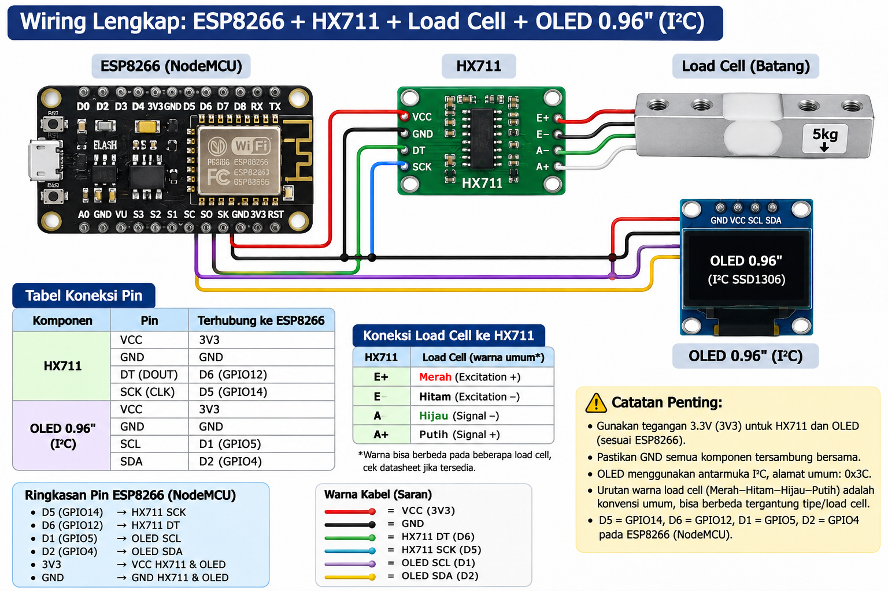

# ESP8266 Load Cell Measurement System


> Sistem pengukuran berat berbasis ESP8266 menggunakan **Load Cell + HX711** dengan **OLED 0.96"** sebagai display lokal.

---

## 🔌 Wiring Diagram

Diagram wiring utama project:



### Pin Connection

| Komponen | Pin | ESP8266 |
|---|---|---|
| **HX711** | VCC | 3V3 |
| | GND | GND |
| | DT / DOUT | D6 (GPIO12) |
| | SCK / CLK | D5 (GPIO14) |
| **OLED 0.96"** | VCC | 3V3 |
| | GND | GND |
| | SCL | D1 (GPIO5) |
| | SDA | D2 (GPIO4) |

### Load Cell → HX711

| HX711 | Load Cell |
|---|---|
| E+ | Merah* |
| E− | Hitam* |
| A− | Hijau* |
| A+ | Putih* |

> **Catatan:** konfigurasi warna kabel load cell dapat berbeda tergantung jenis dan produsen load cell. Jangan menjadikan warna kabel sebagai acuan mutlak; periksa datasheet atau identifikasi kabel apabila diperlukan.

---

# 📖 About The Project

Project ini merupakan implementasi sistem akuisisi data berat menggunakan **ESP8266**, **HX711**, dan **load cell**.

HX711 digunakan sebagai ADC khusus untuk membaca sinyal kecil dari strain gauge pada load cell. Data hasil pembacaan kemudian diproses oleh ESP8266 dan ditampilkan secara lokal menggunakan OLED 0.96" berbasis komunikasi I²C.

Project ini dikembangkan sebagai bagian dari kegiatan praktikum/proyek instrumentasi dan menjadi salah satu dokumentasi pembelajaran mengenai:

- Data acquisition
- Sensor interfacing
- ADC dan strain gauge
- Embedded system
- Sensor calibration
- Signal processing
- Microcontroller programming

---

# 👥 Kelompok

### Nama Kelompok
**[NAMA KELOMPOK]**

### Anggota

| No. | Nama | NIM | Peran |
|---:|---|---|---|
| 1 | [Nama Anggota 1] | [NIM] |
| 2 | [Nama Anggota 2] | [NIM] |
| 3 | [Nama Anggota 3] | [NIM] | 
| 4 | [Nama Anggota 4] | [NIM] | 
| 5 | [Galuh Kurnia Pratama] | [23030224105] |  

---

# 📸 Project Documentation

Karena project ini juga menjadi bagian dari perjalanan semester akhir, dokumentasi proses pengerjaan disimpan di repository sebagai arsip project.

### Perakitan


### Pengujian


### Dokumentasi Kelompok


> Foto dokumentasi dapat ditambahkan atau diganti sesuai proses perkembangan project.

---

# 🧩 Hardware

Komponen utama yang digunakan:

- ESP8266 NodeMCU
- HX711 Load Cell Amplifier / ADC
- Load Cell
- OLED 0.96" I²C SSD1306
- Jumper wires
- USB cable
- Breadboard (jika digunakan)

---

# 💻 Software

Software dan library yang digunakan:

- Arduino IDE
- ESP8266 Arduino Core
- HX711 Library
- Adafruit GFX Library
- Adafruit SSD1306 Library

---

# ⚙️ System Architecture

```text
              LOAD CELL
                  │
                  │ Analog Signal
                  ▼
               HX711
          24-bit ADC Module
                  │
                  │ Digital Data
                  ▼
             ESP8266
          ┌───────┴───────┐
          │               │
          ▼               ▼
       Processing        OLED
                         Display
```

Alur pengukuran:

```text
Load Cell
    ↓
HX711
    ↓
ESP8266
    ↓
Data Processing
    ↓
OLED Display
```

---

# 🚀 Getting Started

## 1. Clone Repository

```bash
git clone https://github.com/[USERNAME]/[REPOSITORY].git
cd [REPOSITORY]
```

## 2. Open Firmware

Buka file:

```text
firmware/
└── esp8266_hx711_oled/
    └── esp8266_hx711_oled.ino
```

menggunakan Arduino IDE.

## 3. Install Library

Pastikan library berikut sudah tersedia:

```text
HX711
Adafruit GFX Library
Adafruit SSD1306
```

## 4. Configure Board

Pada Arduino IDE pilih:

```text
Board  : NodeMCU 1.0 (ESP-12E Module)
Port   : COMx
```

Sesuaikan port dengan perangkat ESP8266 yang digunakan.

## 5. Upload

Hubungkan ESP8266 menggunakan USB kemudian upload firmware.

---

# ⚖️ Calibration

Kalibrasi diperlukan agar pembacaan raw value dari HX711 dapat dikonversi menjadi satuan berat.

Proses dasar:

```text
1. Pastikan load cell tidak diberi beban
              ↓
2. Tare / Zeroing
              ↓
3. Letakkan beban yang diketahui massanya
              ↓
4. Baca nilai HX711
              ↓
5. Tentukan calibration factor
              ↓
6. Uji menggunakan beberapa massa
```

Contoh titik pengujian:

```text
0 g
100 g
200 g
500 g
1000 g
```

> Nilai massa pengujian harus disesuaikan dengan kapasitas load cell yang digunakan.

---

# 📊 Data Acquisition

Data yang diperoleh dari HX711 pada tahap awal berupa raw ADC value.

Secara konseptual:

```text
Load / Force
     ↓
Strain Gauge Deformation
     ↓
Electrical Signal
     ↓
HX711 ADC
     ↓
Raw Digital Value
     ↓
Calibration
     ↓
Weight
```

Pada tahap berikutnya, sistem dapat dikembangkan dengan filtering seperti moving average atau median filtering untuk mengurangi noise pembacaan.

---

# 🛠️ Project Status

| Feature | Status |
|---|---|
| ESP8266 setup | ✅ |
| HX711 interface | ✅ |
| OLED interface | ✅ |
| Wiring | ✅ |
| Load cell integration | 🚧 |
| Tare / zero calibration | 🚧 |
| Weight calibration | 🚧 |
| Noise filtering | 🔲 |
| Data logging | 🔲 |
| Experimental analysis | 🔲 |

**Legend:**

- ✅ Completed
- 🚧 In Progress
- 🔲 Planned

---

# 🗂️ Repository Structure

```text
.
├── firmware/
│   └── esp8266_hx711_oled/
│       └── esp8266_hx711_oled.ino
│
├── docs/
│   └── images/
│       ├── wiring.png
│       ├── perakitan.jpg
│       ├── pengujian.jpg
│       └── kelompok.jpg
│
├── README.md
└── LICENSE
```

---

# 📌 Future Development

Pengembangan berikutnya direncanakan meliputi:

- [ ] Integrasi load cell dengan HX711
- [ ] Tare / zeroing
- [ ] Kalibrasi menggunakan massa referensi
- [ ] Pengujian linearitas
- [ ] Pengujian repeatability
- [ ] Analisis error pengukuran
- [ ] Implementasi filtering
- [ ] Data logging
- [ ] Visualisasi data hasil pengukuran

---

# 🎓 Project Documentation

Project ini dibuat sebagai bagian dari proses pembelajaran dan dokumentasi kegiatan akademik.

Repository ini tidak hanya menyimpan source code, tetapi juga dokumentasi hardware, wiring, proses pengujian, dan perkembangan sistem dari tahap awal hingga implementasi akhir.

> **A small project, a lot of memories.**  
> Semester akhir, solder, kabel jumper, error compile, dan debugging—semuanya ikut tersimpan di sini. :)